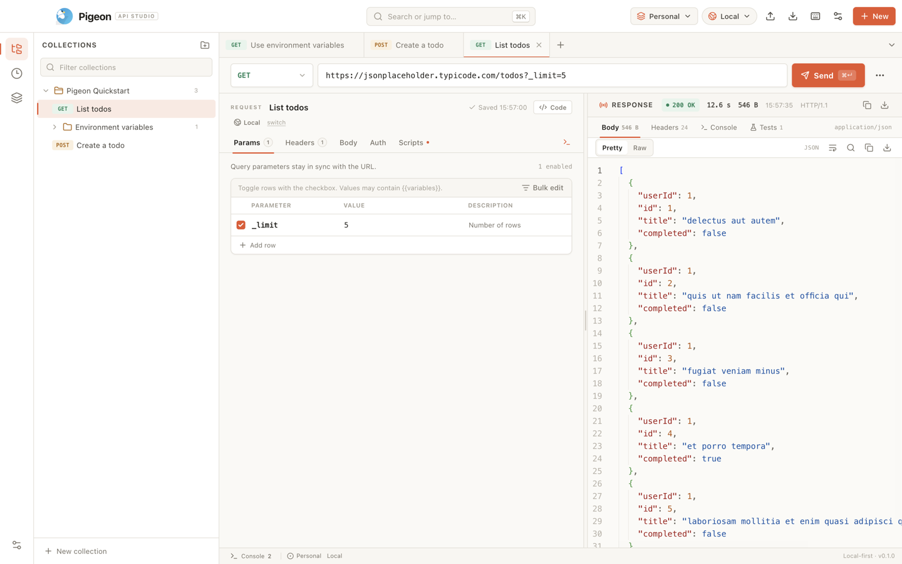
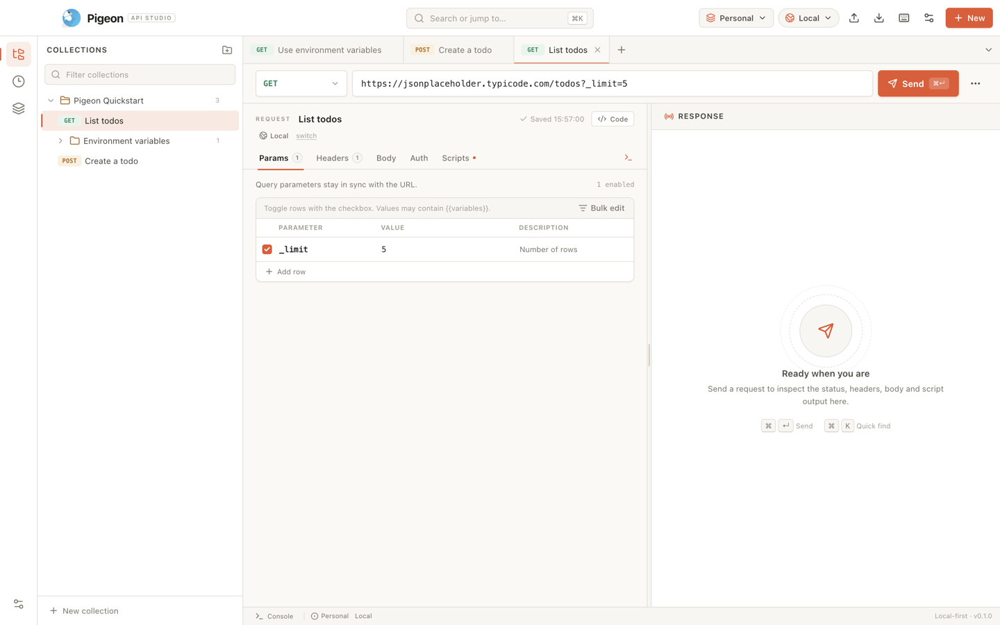
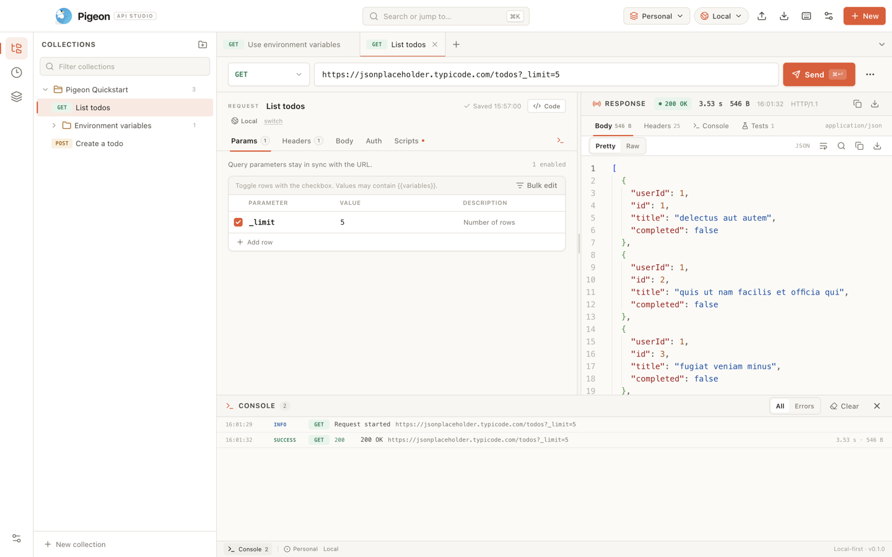
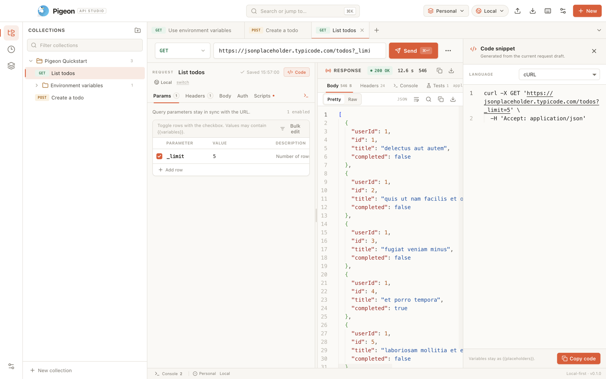
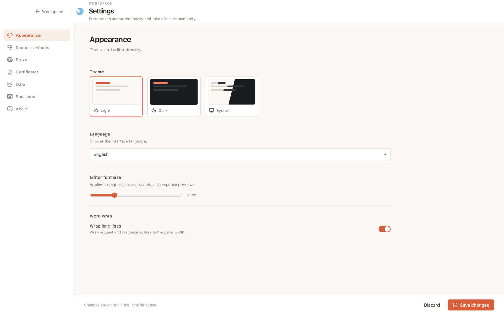
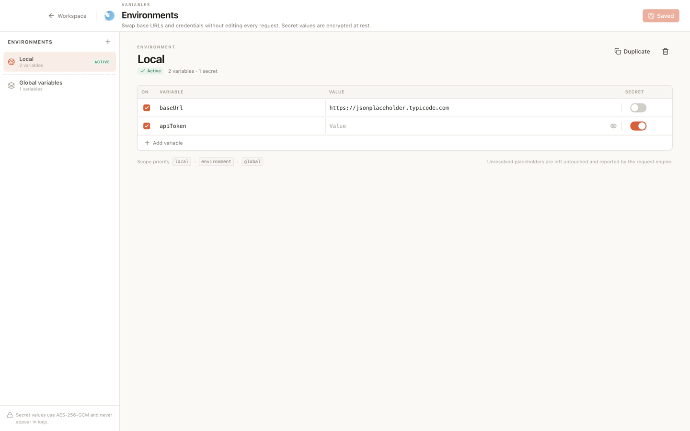
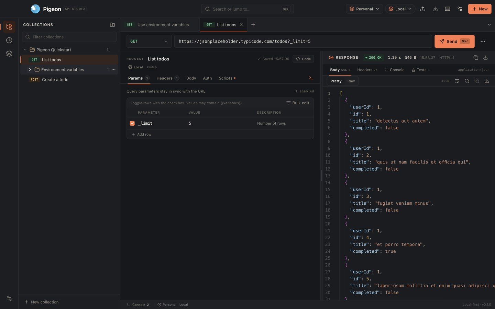
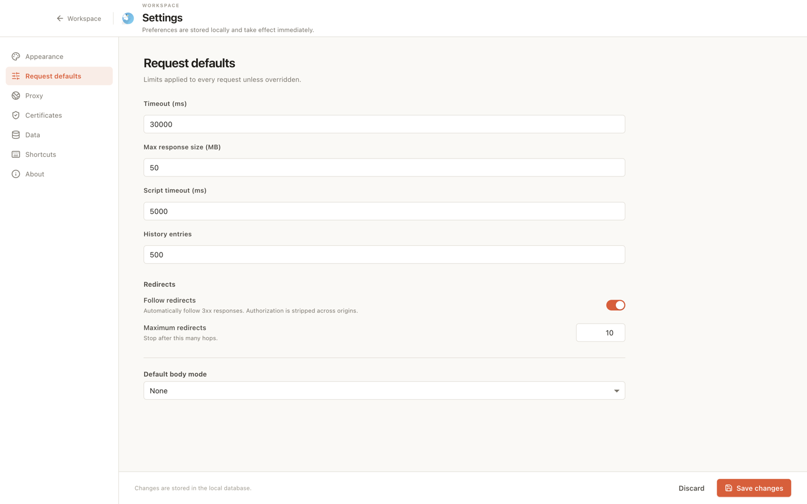
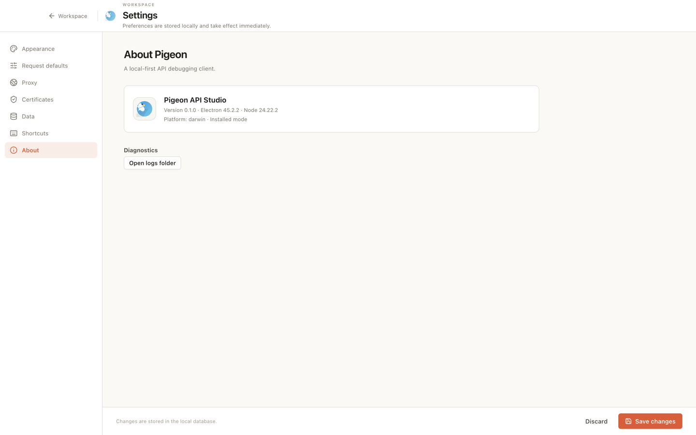

# Pigeon — API Studio

A local-first, multi-workspace API debugging client.



## Core capabilities

### Request engine (Electron main process)
- `GET / POST / PUT / PATCH / DELETE / HEAD / OPTIONS / CONNECT`
- URL/query synchronization, header presets and bulk editing
- Raw, form-data (with files), URL-encoded and binary bodies
- Variable resolution with local > environment > global precedence and dynamic variables
- Timeouts, redirects with cross-origin auth stripping, cancellation, response size limits
- Streaming collection of gzip / deflate / Brotli responses
- System/custom HTTP/SOCKS proxies, custom CAs, PEM/PFX client certificates
- Bounded response storage on disk with paged text previews and binary/image handling

### Workspace, collections, scripts, history
- Multiple workspaces with isolated collection trees, environments and history
- Collection → folder → request tree with drag-and-drop move and reorder
- Inherited pre-request/test scripts and a sandboxed `pm` API subset
- AES-256-GCM encryption for secret variables and client-certificate passphrases
- Auto-recorded history with search, pagination, reopen, save-to-collection and delete
- Postman Collection v2.1 and Environment import/export; HAR 1.2 import/export
- Workspace-scoped backup and restore

### Desktop UX
- Postman-style three-pane workspace, unlimited tabs, duplicate/close/close-others
- Autosave for collection requests; unsaved draft protection on close
- Command palette, configurable shortcuts, light/dark/system themes
- Response Pretty/Raw/HTML preview, headers, sent headers, Console and Test Results
- Global request Console dock with All/Errors filters
- Independent right-side code snippet panel with syntax-highlighted Monaco output
- Full-screen Settings and Environment manager pages

## Screenshots

| Workspace + left/right split | Global Console |
| --- | --- |
|  |  |

| Code snippets | Settings |
| --- | --- |
|  |  |

| Environments | Dark theme |
| --- | --- |
|  |  |

| Flattened Request Defaults | Lean About page |
| --- | --- |
|  |  |

## Getting started

Requirements: Node.js 22.12+ and pnpm 10+.

```bash
pnpm install
pnpm dev          # electron-vite dev
pnpm typecheck    # TypeScript 7 main + renderer
pnpm lint         # oxlint
pnpm i18n:validate
pnpm test         # 58 unit/integration tests
pnpm build        # production bundles in out/
pnpm dist:dir     # unpacked app in release/mac-arm64/Pigeon.app
pnpm verify:package # assert the packaged app has its resources
pnpm dist         # dmg / nsis / AppImage
pnpm build:mac    # platform package (also build:win / build:linux)
pnpm run ci       # i18n + lint + typecheck + tests + build
```

In restricted environments, set `electron_config_cache` to a writable folder before installing Electron.

### Local data

| Mode | Location |
| --- | --- |
| Default | `app.getPath('userData')` (e.g. `~/Library/Application Support/Pigeon`) |
| Portable | `data/` next to the executable when a `portable` marker file exists |
| Override | `PIGEON_DATA_DIR=/path` or `--data-dir=/path` |

Files: `pigeon.db`, `vault.key`, `logs/pigeon.log`, `tmp/responses/`. **Settings → Data** can move the data folder; Pigeon copies a consistent database snapshot and the vault key, then restarts.

## Security notes

- Secret variables are encrypted before touching the local database. `vault.key` is separate, mode `0600`, and the AES key is derived with a machine-bound HKDF salt.
- Scripts run in a null-prototype `node:vm` context with string code generation disabled and no host bindings. This is an application sandbox, not an OS sandbox.
- TLS verification can be disabled only through an explicit setting with a persistent warning.
- IPC payloads are Zod-validated and accepted only from the main window.
- No telemetry or automatic uploads.

## Verification

- `pnpm typecheck` — main and renderer pass with TypeScript 7.
- `pnpm lint` — oxlint with zero warnings.
- `pnpm i18n:validate` — `en` and `zh-CN` catalogs are complete and in sync.
- `pnpm test` — **58 tests** across URL/variable resolution, i18n, code generation, script sandbox, crypto, HTTP client, database/workspace isolation, request-engine integration, Postman/HAR parsing and workspace backup restore.
- `pnpm build` and `electron-builder --dir --mac` produce the packaged app.
- UI smoke-tested from the production bundle in headless Chromium; light, dark and Chinese locale verified.
